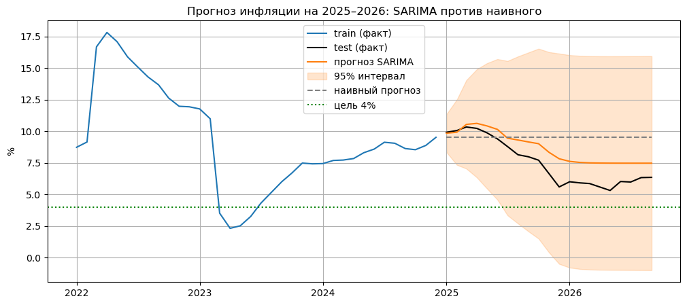

# Инфляция в России: ARIMA и VAR

Мне было интересно, насколько хорошо простые модели временных рядов
предсказывают инфляцию в России и что меняется, если учесть ключевую ставку.
Взяла данные Банка России за 2013–2026 гг., обучила модели на данных до конца
2024 г. и проверила прогноз на 2025–2026 гг.

## Что получилось

SARIMA ошибается в 2 раза меньше наивного прогноза (RMSE 1.33 против 2.68 п.п.)
и замечает разворот инфляции в начале 2025 г. Но снижение после него модель
недооценивает: она знает только прошлую инфляцию и ничего не знает о ставке 21%.
Поэтому следующий шаг — VAR, где инфляция и ставка влияют друг на друга.

## Шаги

1. [01_data.ipynb](01_data.ipynb) — данные и графики. Видно три пика инфляции
   (2015, 2022, 2025), и ставка поднимается раньше пика на 2–5 месяцев.
2. [02_stationarity.ipynb](02_stationarity.ipynb) — ADF-тест: сами ряды
   нестационарны, а их месячные изменения стационарны.
3. [03_arima.ipynb](03_arima.ipynb) — выбор модели по ACF/PACF и AIC. Важны
   лаг 1 (инерция) и лаг 12 (эффект базы в инфляции год к году).
4. `04_var.ipynb` — *в работе:* VAR с ключевой ставкой, тест Грейнджера,
   функции отклика.

Данные: [cbr.ru](https://www.cbr.ru/hd_base/infl/), очищенная версия — `data.csv`.
Python, pandas, statsmodels, matplotlib, Altair.
